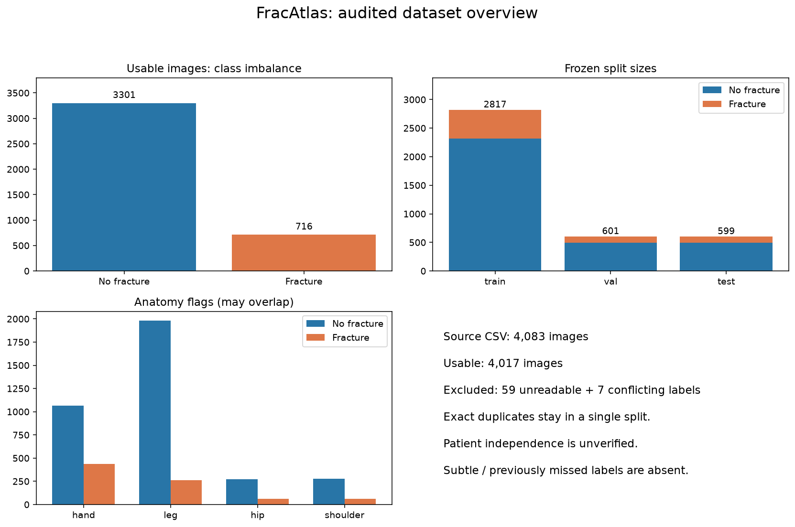
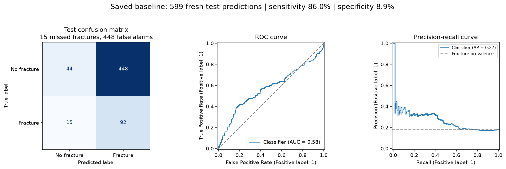
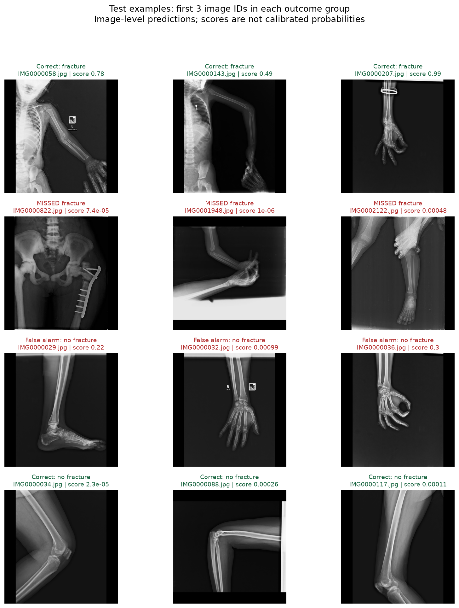

# Fracture Detection in X-rays with FracAtlas

This project uses the supplied `FracAtlas.zip` to classify complete X-rays as fracture/no fracture. The primary research question is: **how many fractures are missed at a validation-selected sensitivity target, and how many false alarms does that operating point produce?**

This repository documents a completed classification baseline, a data-quality audit, and a fresh test-inference run. It includes the source code, trained baseline checkpoint, frozen split manifest, metrics, prediction CSVs, and visualizations. The original dataset archive and extracted source images remain local; obtain them from [FracAtlas on Figshare](https://doi.org/10.6084/m9.figshare.22363012) and place `FracAtlas.zip` in the project root. Reproducible feature caches and Python environments are also excluded from version control.

## What was completed

1. Extracted the supplied FracAtlas archive and inspected the CSV, X-rays, bounding boxes, and polygon annotations.
2. Audited every CSV-listed image, checked decoded-image duplicates, and investigated inconsistent folder labels.
3. Quarantined 59 unreadable JPEGs and seven images in three duplicate groups with contradictory labels. The unreadable files were verified against the source ZIP.
4. Created stratified train/validation/test splits with seed 42, keeping identical images in one split.
5. Trained a CPU baseline with class weighting to address imbalance.
6. Selected a threshold on validation data to target 95% sensitivity, then evaluated the frozen model on the test split.
7. Generated class-balance, split, anatomy, confusion-matrix, ROC, precision-recall, and prediction-example plots.
8. Reopened all 599 original test images and ran the saved checkpoint again. Scores matched the original predictions within `1e-6`; neither the model nor threshold changed.
9. Checked split integrity, false-negative accounting, and saved-model inference. Added a separate ResNet18 training implementation for future experiments.

**Completed model:** balanced logistic regression on whole-image intensity/gradient features. **CNN status:** implemented, not trained or runtime-tested in this environment. **Localization status:** reference-annotation visualization only; no detector or segmentation model has been trained.

## Dataset and split summary

The supplied CSV contains 4,083 images: 719 fracture and 3,364 no-fracture labels. After explicit exclusions, 4,017 images remain.

| Split | No fracture | Fracture | Total |
| --- | ---: | ---: | ---: |
| Train | 2,316 | 501 | 2,817 |
| Validation | 493 | 108 | 601 |
| Test | 492 | 107 | 599 |
| Total | 3,301 | 716 | 4,017 |



## Results from the saved baseline

| Test measure | Validation-selected threshold | Default threshold 0.5 |
| --- | ---: | ---: |
| Sensitivity | 86.0% | 36.4% |
| Specificity | 8.9% | 83.7% |
| Missed fractures | 15 / 107 | 68 / 107 |
| False alarms | 448 / 492 | 80 / 492 |
| Precision | 17.0% | 32.8% |

The selected threshold is `0.0006424671737477183`. It achieved 95.4% sensitivity on validation data, but 86.0% on test data. Test ROC AUC is 0.575 and average precision is 0.272. Test sensitivity has a Wilson 95% interval of approximately 78.2% to 91.3%.

Lowering the threshold caught more fractures but flagged most normal images. This baseline has weak discrimination and does not establish reliable detection of subtle injuries. Its scores are not calibrated clinical probabilities.





## Browse the saved outputs

- [Detailed experiment results](RESULTS_baseline.md)
- [Data audit and exclusions](artifacts/data_audit.json)
- [Frozen image splits and metadata](artifacts/manifest.csv)
- [Trained baseline checkpoint](artifacts/baseline/model.joblib)
- [All fresh test predictions](test_predictions.csv)
- [Fresh-inference verification and checkpoint hash](inference_summary.json)
- [Missed fractures with human reference annotations](artifacts/baseline/missed_fractures.png)

Download the repository and open `visual_report.html` locally to browse all test images after restoring the dataset. GitHub displays the PNG previews above; it does not run the HTML report as an application. Individual X-ray references in the HTML require the local `data/raw/FracAtlas/` folder.

The completed CPU run is summarized in [RESULTS_baseline.md](RESULTS_baseline.md). It uses 4,017 usable images after 59 decode failures and seven images in three conflicting-label groups are quarantined. On 599 test images it misses 15 of 107 fractures (86.0% sensitivity), with 8.9% specificity at the validation-selected threshold. This weak discrimination makes it a reference baseline; it is not evidence of reliable subtle-fracture detection. CNN code is supplied separately and has not been trained or runtime-tested here.

To visualize the dataset and run the saved model again on every original test image, run `python visualize_test.py`. Open [the visual test report](artifacts/test_replay/index.html) for class balance, split and anatomy charts, test curves, prediction examples, and all 599 labeled test images. Fresh predictions and checkpoint verification are saved in `artifacts/test_replay/`. This command does not retrain the model or change its threshold.

## Run the CPU baseline

From PowerShell in this folder:

```powershell
python -m venv .venv
.\.venv\Scripts\Activate.ps1
python -m pip install -r requirements.txt
python prepare.py --exclude-unreadable --exclude-conflicting
python train_baseline.py --target-sensitivity 0.95
python review.py
python verify.py
python report.py
python predict.py "data/raw/FracAtlas/images/Fractured/IMG0000019.jpg"
```

To use the included checkpoint without retraining, restore/extract the source dataset, then run:

```powershell
python -m zipfile -e FracAtlas.zip data/raw
python verify.py
python visualize_test.py
python predict.py "path/to/xray.jpg"
```

The committed manifest is the reference split. Do not rerun `prepare.py` merely to replay the saved checkpoint: preparation regenerates the split file. For a new training experiment, use the full preparation command above and retain the resulting manifest with its run. Load only trusted `.joblib` checkpoints. The original run's package versions are recorded in [environment.txt](environment.txt); use a compatible environment when loading its scikit-learn checkpoint.

The baseline is balanced logistic regression on 64×64 image intensities and gradients. It establishes a reproducible reference and exercises the complete evaluation pipeline. Its resolution is insufficient to claim reliable detection of subtle fractures.

## Train the CNN

Use a Python version supported by the installed PyTorch release (Python 3.12 is a practical separate environment). The current local Python 3.14 environment did not offer a compatible PyTorch package during setup. No CNN results are claimed until this run completes.

```powershell
py -3.12 -m venv .venv
.\.venv\Scripts\python.exe -m pip install -r requirements-cnn.txt
.\.venv\Scripts\python.exe train_cnn.py --epochs 15 --size 384 --batch-size 16
.\.venv\Scripts\python.exe review.py --model cnn
.\.venv\Scripts\python.exe predict.py "path/to/xray.jpg" --model cnn
```

ResNet18 starts with ImageNet weights, trains with a positive-class-weighted binary loss computed on training data only, and uses small training-only rotations. Letterboxing retains the entire X-ray. Epoch selection uses validation average precision, with early stopping. The final threshold is the highest validation threshold achieving the requested empirical sensitivity. The frozen model and threshold are evaluated once on test data. A 95% validation target does **not** guarantee 95% test or clinical sensitivity. Scores are not calibrated probabilities. Change experiment settings using validation results; repeated optimization against the test report invalidates its held-out status.

The first pretrained run requires internet to obtain weights. `--from-scratch` bypasses that download but is a different experiment. CPU CNN training can be slow; a GPU is preferable. Raising image size may preserve small injury detail but needs independent validation.

## Data and evaluation

`prepare.py` extracts the archive with path checks, reads every image, checks labels of identical decoded images, and groups exact duplicates before creating approximately 70/15/15 stratified train/validation/test splits with seed 42. All labels and metadata stay in `artifacts/manifest.csv`. By default it fails on JPEG decode errors or conflicting duplicate labels. `--exclude-unreadable` records and excludes decode failures; `--exclude-conflicting` quarantines entire identical-image groups with inconsistent labels. Both exclusions are recorded in the audit. `IMG0004028.jpg`, for example, is truncated in the source ZIP itself (the extracted bytes match). The original 4,083 CSV entries are therefore not all used for training. Rerunning preparation overwrites this manifest; keep it fixed for model comparisons. Use `--skip-extraction` to reuse already extracted files.

Patient IDs are absent from the provided CSV. Exact duplicate grouping cannot prevent leakage from near duplicates or related views from one patient. These are **image-level research splits**, not verified patient-independent evaluation. Obtain patient/study grouping before making stronger generalization claims.

Two identical files appear in both class folders (`IMG0003375.jpg` and `IMG0003376.jpg`); their CSV labels both indicate fracture. Preparation verifies the repeated contents agree, uses the CSV as the label source, and selects the matching class-folder copy. Do not derive labels solely from the archive's folder names. Radiographic text, anatomy, hospital style and hardware may also create shortcuts; review these alongside errors.

Class imbalance is addressed through balanced class weights in the baseline and positive weighting in the CNN, without resampling validation/test data. Primary outputs include sensitivity, false-negative count/rate, specificity, precision, negative predictive value, ROC AUC, and average precision. Sensitivity includes a Wilson 95% interval; these intervals do not account for potentially correlated patient views. Reported subgroup metrics are descriptive and overlapping, and small subgroups are uncertain.

Outputs:

| Path | Contents |
| --- | --- |
| `data/raw/FracAtlas/` | Extracted images, CSV and original annotations |
| `artifacts/data_audit.json` | Counts, class balance, duplicates, split sizes and limitations |
| `artifacts/manifest.csv` | Reproducible image-to-split assignment, hashes and metadata |
| `artifacts/baseline/` | Actual CPU checkpoint, configuration, metrics, curves and predictions |
| `artifacts/cnn/` | Equivalent CNN outputs after CNN training |
| `*/false_negatives.csv` | Images missed at the validation-selected threshold |
| `*/missed_fractures.png` | Missed images with human reference boxes and polygon outlines |

## Source files

| File | Purpose |
| --- | --- |
| `prepare.py` | Extract, audit, quarantine and assign duplicate-group splits |
| `common.py` | Shared paths, preprocessing, threshold selection and metrics |
| `train_baseline.py` | Train the weighted CPU classification baseline |
| `train_cnn.py` | Optional ResNet18 transfer-learning experiment |
| `predict.py` | Run a saved baseline or CNN on a local X-ray |
| `review.py` | Overlay human reference boxes and outlines on missed cases |
| `visualize_test.py` | Plot the data and run fresh inference on every test image |
| `verify.py` | Check evaluation semantics and split integrity |
| `report.py` | Build the readable results summary from actual metrics |
| `package_github.py` | Build a source-and-results upload bundle with checksums |

Generated reports and the trained baseline checkpoint are included for inspection. Raw data, the source ZIP, the feature cache, pretrained weight downloads, virtual environments, and Python bytecode are excluded. The original source data can be obtained through the Figshare link; exclusions do not delete local files.

## Finding and locating subtle injuries

The supplied bounding boxes and segmentation polygons are preserved. `review.py` overlays these **human reference annotations**, not predicted locations. The classification models predict image-level fracture scores and do not provide validated fracture coordinates or masks. A high sensitivity score alone does not establish localization quality.

Next localization experiment: train a detector or segmentation model using the **same frozen manifest**, include normal images as negatives, and evaluate lesion recall at specified IoU and false positives per image (FROC), alongside image-level sensitivity. Do not use human annotations at inference. Evaluate small lesion areas as a separate descriptive subgroup, but do not equate small size with radiological subtlety. No explicit subtle-fracture or previously-missed label exists here; obtain expert adjudication to answer that question directly.

For each false negative, review anatomy, view, hardware, multiscan status, lesion size, and whether resizing obscured the fracture. Record findings before altering training. External hospital testing and expert review are needed before clinical use; this project is a research experiment.

## Sources

- [FracAtlas dataset on Figshare](https://doi.org/10.6084/m9.figshare.22363012)
- [Original Scientific Data paper](https://www.nature.com/articles/s41597-023-02432-4). Cite the authors and respect the dataset's terms when using or redistributing it.
- [Author repository](https://github.com/XLR8-07/FracAtlas)
- [Torchvision ResNet18 documentation](https://docs.pytorch.org/vision/stable/models/generated/torchvision.models.resnet18.html)
- [Scikit-learn ROC threshold documentation](https://scikit-learn.org/stable/modules/generated/sklearn.metrics.roc_curve.html)
