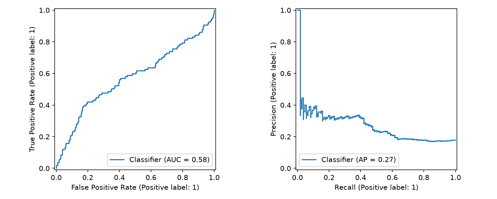
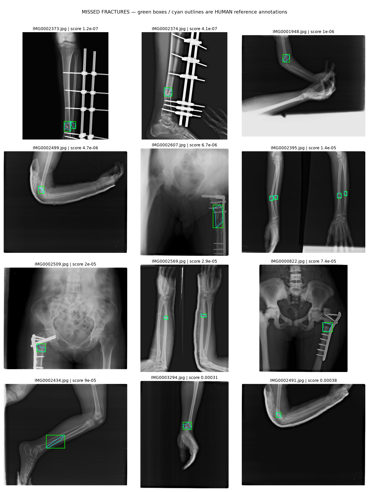

# FracAtlas results: baseline

This report summarizes an actual completed image-level research experiment.

Source images: 4083. Usable images: 4017. Excluded unreadable images: 59. Quarantined conflicting groups: 3.

Class counts (0=no fracture, 1=fracture): {'0': 3301, '1': 716}.

Frozen splits: {'train': {'0': 2316, '1': 501}, 'val': {'0': 493, '1': 108}, 'test': {'0': 492, '1': 107}}.

Target validation sensitivity: 95.0%. Selected threshold: 0.000642. Validation sensitivity: 95.4%.

| Test measure | Validation-selected threshold | Threshold 0.5 |
| --- | ---: | ---: |
| sensitivity | 86.0% | 36.4% |
| specificity | 8.9% | 83.7% |
| precision | 17.0% | 32.8% |
| negative predictive value | 74.6% | 85.8% |
| false negative rate | 14.0% | 63.6% |
| TP | 92 | 39 |
| FN | 15 | 68 |
| FP | 448 | 80 |
| TN | 44 | 412 |

Test ROC AUC: 0.575; average precision: 0.272. Test fracture prevalence (reference level for average precision): 0.179.

Test sensitivity Wilson 95% interval: 78.2% to 91.3%.

## Interpretation

Assess sensitivity together with specificity and false positives. A high sensitivity obtained by flagging most normal images does not demonstrate useful discrimination. The validation sensitivity target is an empirical operating point and is not a guaranteed test result.

The baseline uses coarse image/gradient features and is a reference experiment. CNN training is separate. There are no subtle-fracture or previously-missed labels; these results cannot establish performance on those groups. Patient independence is unverified; exact duplicates are grouped but related views may remain. External evaluation and expert adjudication are still needed.

## Error review

[Test predictions](artifacts/baseline/test_predictions.csv) · [False negatives](artifacts/baseline/false_negatives.csv) · [Detailed metrics](artifacts/baseline/metrics.json)

The following review shows HUMAN reference annotations on missed images, not model-predicted locations.

